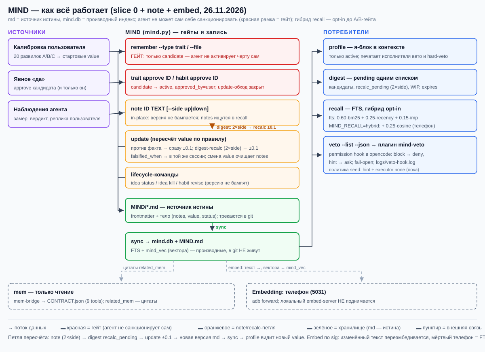

# MIND

A local-first cognitive layer for an AI agent: traits, habits, ideas and
insights stored as plain markdown files, indexed in SQLite, served over
MCP. Activation gates live in code - the agent cannot sanction itself.



## Principles

- **Markdown is the source of truth.** `MIND/*.md` records are the store;
  `mind.db` (FTS5 + vectors) and `MIND.md` are derived indexes, rebuilt
  by `sync`, never edited by hand.
- **Honesty gates are enforced by code.** A new trait or habit starts as
  a `candidate`; only the user can approve it (`trait approve`,
  `habit approve`). An idea cannot skip its state machine. A trait value
  change consumes the observations that triggered it.
- **One-way bridge to mem.** The outer memory server is reached
  read-only through a pinned contract (`CONTRACT.json`); `doctor mem`
  reports drift instead of hiding it.
- **Local-first, stdlib-only.** Single-file `mind.py`, no runtime
  dependencies. Optional embeddings go to a remote endpoint you
  configure; when it is down, search falls back to FTS and never stalls.

## Quick start

```bash
git clone https://github.com/dosermen/MIND.git
cd MIND
python mind.py sync              # build mind.db from MIND/*.md
python mind.py recall "defrag"   # ranked FTS search
python mind.py profile           # compact self-block for the agent
python mind.py digest            # everything pending, one list
python -m unittest discover -s tests
```

## CLI

| command | what it does |
|---|---|
| `sync [--lenient]` | rebuild `mind.db` and `MIND.md` from records |
| `remember` / `update` / `forget` / `restore` | record lifecycle; TEXT starting with `---` is parsed as frontmatter+body |
| `recall QUERY` | FTS5 ranking: `0.60*bm25 + 0.25*recency + 0.15*importance` |
| `note ID TEXT [--side up\|down]` | observation on a trait, in-place; 2 same-side notes make `digest` remind about a value recalc |
| `idea new/status/kill`, `habit approve/exception/revise`, `trait approve` | lifecycle commands, gates in code |
| `veto ACTION [--list]` | evaluate hard-veto rules; rc 0 allow / 1 prohibited / 2 no action |
| `profile`, `digest`, `list`, `show`, `link` | read paths |
| `embed` | fill vectors from the remote endpoint (`MIND_EMBED_URL`), batched with resume |
| `doctor mem [--deep]` | contract check against the outer memory server |
| `serve` | MCP stdio server (below) |

Exit codes: 0 ok, 1 validation/drift/not found, 2 hard error.

## MCP server

`python mind.py serve` speaks newline-delimited JSON-RPC 2.0 over stdio
(protocol `2024-11-05`, same shape as `mem.py serve`). Thirteen tools:
`recall profile digest show list note remember update forget restore
veto idea habit`. Mutating tools take the same single-writer lock as
the CLI; a failing tool returns an error text, the server stays up.

opencode config:

```json
"mcp": {
  "servers": {
    "mind": {
      "type": "local",
      "command": ["python", "/path/to/MIND/mind.py", "serve"],
      "codemode": false
    }
  }
}
```

## Recall modes

- **Default: pure FTS5** - deterministic, no network.
- **Hybrid (`MIND_RECALL=hybrid`, opt-in)** - adds a vector-only
  candidate pass over `mind_vec` (cosine >= 0.30) with weights
  `0.45*bm25 + 0.20*recency + 0.10*importance + 0.25*cosine`.
  Stays opt-in until an A/B usefulness gate on ~50 records decides it
  beats plain FTS.
- Footers are honest: `fts (no vectors yet)`, `fts (remote server
  down)`, `hybrid partial k/n` - the mode always says what happened.

## Hard veto

A setting may declare `veto_rules: [{id, pattern, reason}]` (regex).
`python mind.py veto ACTION` evaluates every alive setting and reports
the fact, not the opinion. Validation refuses `mode: block` without a
`veto_executor: code|hook` - an LLM cannot enforce a block on its own.

## Layout

```
mind.py          single-file CLI + MCP server (stdlib only)
mem-bridge.py    read-only JSON-RPC client to the outer mem server
CONTRACT.json    pinned contract for that bridge
MIND/            records - the source of truth (tracked in git)
docs/            DESIGN.md - architecture, gates, roadmap
tests/           unittest suite, includes a stub mem server
```

## Status

Implemented: store and sync, entry gates, note/recalc loop, FTS and
hybrid recall, embed, veto rules, MCP serve. Roadmap (background
digest, habit eligible journal, resurrect, reflect, identity boost) is
in `DESIGN.md`.

## License

MIT - see [LICENSE](LICENSE).
